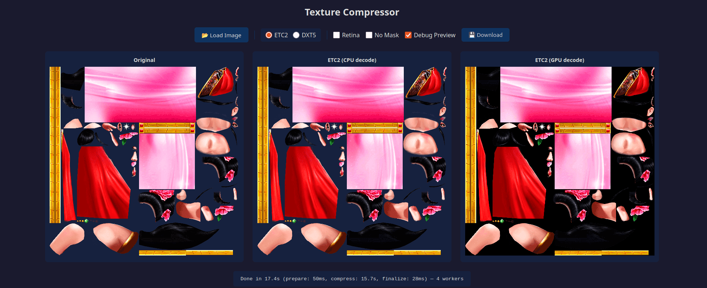

# DXT5 ETC2 texture comporessor

Unified ETC2 + DXT5 (BC3) texture compression tool in Rust.

## Live demo

Try the WebAssembly demo on GitHub Pages:

https://yuriilychak.github.io/dxt5_etc2_texture_comporessor/



## Build

```bash
cargo build --release
```

### WASM

```bash
wasm-pack build --target web -- --no-default-features
```

## Usage

```
texcompress --format <etc2|dxt5> [/retina] [/nomask] src [dst] [/debug result.png]
```

| Flag            | Description                                  |
| --------------- | -------------------------------------------- |
| `--format etc2` | Compress to ETC2 (EAC + ETC2 colour)         |
| `--format dxt5` | Compress to DXT5 / BC3                       |
| `/retina`       | Double the alpha outline radius (ETC2 only)  |
| `/nomask`       | Ignore alpha channel                         |
| `/debug <path>` | Write decompressed PNG for visual comparison |

### Examples

```bash
# Compress to DXT5 with debug output
texcompress --format dxt5 input.png output.dxt5 /debug debug.png

# Compress to ETC2
texcompress --format etc2 input.png output.etc2

# Ignore alpha channel
texcompress --format dxt5 /nomask input.png output.dxt5
```

### Output

```
Loaded input.png
  Image 512x512, Texture 512x512
    Timing: compress 25ms
      SubTexture A PSNR = 44.390360, SSIM_4x4 = 0.99970148
      SubTexture RGB wPSNR = 37.717488, wSSIM_4x4 = 0.98415083
```

## Quality Metrics

Both formats report identical metric types:

- **Alpha PSNR** — Peak Signal-to-Noise Ratio for the alpha channel
- **Alpha SSIM** — Structural Similarity Index (4×4 block-level) for alpha
- **RGB wPSNR** — Perceptually weighted colour PSNR (weights: R=213, G=715, B=72)
- **RGB wSSIM** — Perceptually weighted colour SSIM

## Architecture

```
src/
├── main.rs              # CLI: --format dispatch to engine
├── lib.rs               # Module declarations
├── wasm_api.rs          # WASM: tex_init, *_prepare, *_compress_chunk, tex_finalize
├── shared/
│   ├── mod.rs           # TextureEngine trait + CompressResult
│   ├── types.rs         # TextureFormat enum, perceptual weights, SSIM constants
│   ├── image_io.rs      # PNG load/save (RGBA)
│   ├── texture.rs       # Padding, alpha masking
│   └── quality.rs       # SSIM + PSNR metrics
├── etc2/
│   ├── mod.rs           # Etc2Engine: RGBA↔BGRA boundary, separate α/colour passes
│   ├── compress_alpha.rs
│   ├── compress_color.rs
│   ├── decompress.rs
│   ├── tables.rs        # 32 MB lookup tables (init once)
│   ├── ssim.rs          # BGRA-native SSIM (used by colour compressor)
│   └── ...
└── dxt5/
    ├── mod.rs           # Dxt5Engine: RGBA-native, single-pass α+colour
    ├── compress.rs      # Block + image compression/decompression
    ├── compress_alpha.rs
    ├── colourblock.rs
    ├── colourset.rs
    ├── colourfit/       # Cluster, range, single fitting algorithms
    ├── math.rs          # Vec3, Vec4, Sym3x3
    └── types.rs
```

### Pixel Order

- **ETC2 engine** operates in BGRA internally (inherited from C++ SIMD code).
  The `Etc2Engine` wrapper converts RGBA→BGRA at input and BGRA→RGBA at output.
- **DXT5 engine** operates in RGBA natively — no conversion needed.
- **Shared modules** (quality, texture, image_io) all use RGBA.

### WASM Pipeline

Four-stage WebWorker pipeline (same pattern for both formats):

1. `tex_init(format)` — initialize tables (once per worker)
2. `etc2_prepare()` / `dxt5_prepare()` — serialize block data from RGBA input
3. `etc2_compress_chunk()` / `dxt5_compress_chunk()` — compress blocks + compute metrics
4. `tex_finalize(results, w, h, format, debug)` — reassemble + aggregate metrics

Each compressed block produces a unified 40-byte record:
`[block:16, alpha_mse:i32, alpha_ssim:f64, color_mse:i32, color_ssim:f64]`

## Credits

- ETC2 compression is based on https://github.com/Playrix/playrix-public/tree/master/Etc2Compress
- DXT5/BC3 compression is based on https://github.com/jansol/texpresso
